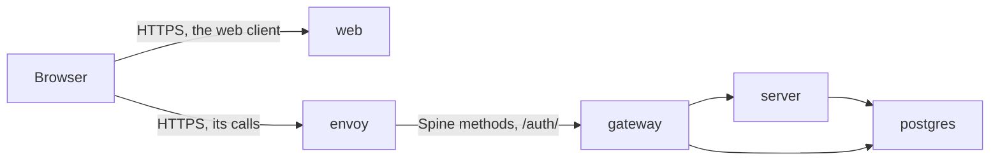

# Access Desk in containers

Runs Access Desk on a developer's machine, each program in a container of its
own, laid out as in production.

| Container  | What it runs                                                                        | Published on this machine at                                                                             |
| ---------- | ----------------------------------------------------------------------------------- | -------------------------------------------------------------------------------------------------------- |
| `web`      | The web client, served by nginx as a hosting service would.                         | `https://<ACCESS_DESK_WEB_HOST>:<ACCESS_DESK_WEB_PORT>`                                                  |
| `envoy`    | The entrance to the application: takes the web client's calls and passes them on.   | `https://<ACCESS_DESK_API_HOST>:<ACCESS_DESK_API_PORT>`                                                  |
| `gateway`  | The gateway: signs people in, keeps their sessions, and decides what they may call. | Not published.                                                                                           |
| `server`   | The application server, with the Identity and Resources bounded contexts.           | Not published.                                                                                           |
| `postgres` | PostgreSQL, with the databases of the application server and the gateway.           | `<ACCESS_DESK_DATABASE_HOST>:<ACCESS_DESK_DATABASE_PORT>`, for the tests and to look into the databases. |

`gateway` and `server` run from one image, each with its own program.



## web

nginx serves the built web client over HTTPS, as a hosting service would. At
`/config.json` it gives the address of `envoy`, `ACCESS_DESK_API_HOST` and
`_PORT`, which the web client calls. Its configuration is in
[`web/templates/`](web/templates).

## envoy

Takes the web client's calls over HTTPS, only from the address of `web`, and
passes on to `gateway` only those `gateway` serves; it refuses the rest. The
paths it passes on are in [`envoy/spine-methods.json`](envoy/spine-methods.json)
and [`envoy/gateway-endpoints.json`](envoy/gateway-endpoints.json): add a new
endpoint of `gateway` there too.

[`envoy/render.mjs`](envoy/render.mjs) renders its configuration from `.env`
when the image is built.

## postgres

Each time it starts, its `post_start` hook creates the databases that are
missing, one for each organization of `ACCESS_DESK_ORGANIZATIONS`, and only
then it reports itself healthy. The databases are kept in the volume
`access-desk_postgres-data`, which `pnpm run postgres:start` uses as well.

## Run it

1. Set up the workspace once, as the root
   [`README.md`](../README.md#set-it-up) describes.
2. Build the images and start the containers:

   ```sh
   pnpm run containers:start
   ```

3. Open the address of `envoy` once and accept its self-signed certificate:
   until then, the browser refuses the web client's calls. `envoy` answers
   there with `404`.
4. Open the address of `web` and sign in.

After a change to the code or to `.env`, run `pnpm run containers:start`
again. Stop the containers with `pnpm run containers:stop`; remove them with
every database with `pnpm run postgres:delete`.
