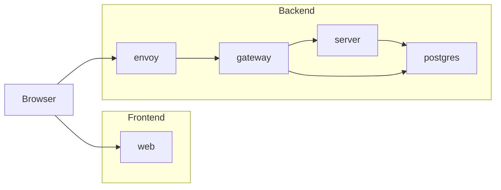

# Access Desk in containers

Runs Access Desk on a developer's machine, each program in a container of its
own, laid out as in production.

| Container  | What it runs                                                                                                             | Published at                                                              |
| ---------- | ------------------------------------------------------------------------------------------------------------------------ | ------------------------------------------------------------------------- |
| `web`      | The web client, served by nginx.                                                                                         | `https://<ACCESS_DESK_WEB_HOST>:<ACCESS_DESK_WEB_PORT>`                   |
| `envoy`    | An Envoy proxy that takes the web client's calls over HTTPS and passes them on to the gateway.                           | `https://<ACCESS_DESK_API_HOST>:<ACCESS_DESK_API_PORT>`                   |
| `gateway`  | The framework's browser server: signs people in through Google and passes their allowed gRPC-Web calls on to the server. | Not published.                                                            |
| `server`   | The gRPC server of the Identity and Resources bounded contexts.                                                          | Not published.                                                            |
| `postgres` | The databases of the application server and the gateway.                                                                 | `<ACCESS_DESK_DATABASE_HOST>:<ACCESS_DESK_DATABASE_PORT>`, for the tests. |

The names in angle brackets are environment variables from `.env`.

`web` is the frontend: the web client, served as a hosting service would.
`envoy`, `gateway`, `server`, and `postgres` are the backend: everything the
web client calls, at one address. The two addresses differ only in port on
this machine, and the browser treats them as different origins, as it treats
two hosts in production.



The containers are joined by separate networks, so each one reaches only the
containers it calls:

- `web` reaches none of them.
- `envoy` reaches only `gateway`.
- `gateway` reaches `server` and `postgres`.

## web

nginx serves the built web client over HTTPS, as a hosting service would. At
`/config.json` it gives the address of `envoy`, from `ACCESS_DESK_API_HOST` and
`ACCESS_DESK_API_PORT`, which the web client calls. The paths of the
certificate come from `compose.yaml`. The configuration of nginx is in
[`web/templates/`](web/templates).

## envoy

Takes the web client's calls over HTTPS, and answers the browser's
cross-origin checks only for the address of `web`. It passes on to `gateway`
only the paths `gateway` serves, and refuses the rest. The paths are listed in
[`envoy/spine-methods.json`](envoy/spine-methods.json), the framework's
methods, and in [`envoy/gateway-endpoints.json`](envoy/gateway-endpoints.json),
the gateway's own endpoints. A new endpoint of `gateway` goes into the second.

[`envoy/render.mjs`](envoy/render.mjs) renders the configuration when the image
is built, from `.env` and from `compose.yaml`, which gives the address of
`gateway`, the paths of the certificate, and the port of the administration
interface.

It reports itself healthy once it is ready to pass calls on, as `/ready` of
its administration interface answers. That interface listens only inside the
container and is not published.

## gateway and server

Both run from one image, each started with its own command from
`compose.yaml`. `server` trusts every call that reaches it, as only `gateway`
shares its network.

## postgres

Each time it starts, its `post_start` hook creates the databases that are
missing, one for each organization of `ACCESS_DESK_ORGANIZATIONS`, and only
then it reports itself healthy. The databases are kept in the volume
`access-desk_postgres-data`, which `pnpm run postgres:start` uses as well.

## Run it

1. Set up the workspace once, as the root
   [`README.md`](../README.md#set-it-up) describes.
2. Build the images and start the containers:

   ```sh
   pnpm run containers:start
   ```

3. Open the address of `envoy` once and accept its self-signed certificate:
   until then, the browser refuses the web client's calls. `envoy` answers
   there with `404`.
4. Open the address of `web` and sign in.

After a change to the code or to `.env`, run `pnpm run containers:start`
again. Stop the containers with `pnpm run containers:stop`, and remove them
with `pnpm run containers:delete`, which keeps the databases. Remove PostgreSQL
with every database with `pnpm run postgres:delete`; the other containers stay.
