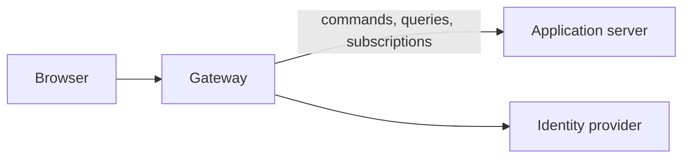

# Access Desk application

The application runs as two programs.

- **The application server** hosts the Identity and Resources contexts. It
  knows nothing of browsers, sessions, or identity providers.
- **The gateway** signs people in, keeps their sessions, and decides what each
  may send on. It holds no part of the application and reaches the server over
  the network.

A browser talks only to the gateway.



## Set it up

All of Access Desk is configured in one file, `.env`, in the root of the
repository. Copy [`.env.example`](../../.env.example) there and fill it in.
The file is ignored by Git.

Every setting is required. Nothing is assumed: a program that misses a
setting refuses to start and names it.

| Variable                   | Read by             | Meaning                                                |
| -------------------------- | ------------------- | ------------------------------------------------------ |
| `ACCESS_DESK_SERVER_HOST`  | server, gateway     | The address the application server listens on.         |
| `ACCESS_DESK_SERVER_PORT`  | server, gateway     | The port the application server listens on.            |
| `ACCESS_DESK_GATEWAY_HOST` | gateway, web client | The address the gateway listens on.                    |
| `ACCESS_DESK_GATEWAY_PORT` | gateway, web client | The port the gateway listens on.                       |
| `ACCESS_DESK_WEB_HOST`     | gateway, web client | The address the web client listens on.                 |
| `ACCESS_DESK_WEB_PORT`     | gateway, web client | The port the web client listens on.                    |
| `GOOGLE_CLIENT_ID`         | gateway             | The client identifier of the Google OAuth application. |
| `GOOGLE_CLIENT_SECRET`     | gateway             | The client secret of the Google OAuth application.     |

People sign in through Google. If the gateway cannot reach Google when it
starts, it does not start.

## Run it

Build once, then start each program in a terminal of its own.

```sh
pnpm --dir packages/app run build
pnpm --dir packages/app run server
pnpm --dir packages/app run gateway
```

## The gateway's endpoints

The gateway has six endpoints of its own, for signing in and for the session.
Everything else a browser does is a Spine command, query, or subscription sent
to the same address; see [What passes through](#what-passes-through).

Every endpoint of its own works the same way:

- It takes `POST` with a JSON object as the body. Send `{}` when there is
  nothing to send. The body may be at most 16 KiB.
- It answers only the page the web client serves, by the `Origin`
  header of the request.
- Where it needs a session, send the session as `Authorization: Bearer <token>`.
- It answers JSON, which must not be cached.

| Status | Body                           | Means                                                            |
| ------ | ------------------------------ | ---------------------------------------------------------------- |
| `200`  | as each endpoint describes     | Done.                                                            |
| `401`  | `{ "error": "not signed in" }` | The endpoint needs a session, and there is none or it has ended. |
| `403`  | `{ "error": "refused" }`       | The person may not do this, or the request is malformed.         |
| `503`  | `{ "error": "try again" }`     | The gateway could not do it just now.                            |

### Signing in

A person signs in in four steps.

1. The page asks which providers it may offer: `/auth/options`.
2. The person chooses one. The page makes up a secret, keeps it, and starts
   the sign-in with the secret's fingerprint: `/auth/external/start`.
3. The page sends the browser to the address it was given. The provider
   confirms the person and sends them back to the page, with `code` and
   `state` in the address.
4. The page finishes the sign-in with those and the secret:
   `/auth/external/complete`. The answer carries the session.

#### `POST /auth/options`

Lists the identity providers a sign-in page may offer. Needs no session.

Send `{}`.

Answers `200`:

```json
{ "external": [{ "key": "google", "label": "Google" }] }
```

`key` is what `/auth/external/start` takes as `provider`. `label` is the name
to show. An empty list means nobody can sign in.

#### `POST /auth/external/start`

Starts a sign-in through one provider. Needs no session.

| Field           | Value                                                                               |
| --------------- | ----------------------------------------------------------------------------------- |
| `provider`      | A `key` from `/auth/options`.                                                       |
| `codeChallenge` | The SHA-256 of a secret the browser has just made up, in base64url without padding. |

The browser keeps the secret itself, 43 to 128 characters long, until the
provider sends the person back.

Answers `200` with the provider's address to send the person to:

```json
{ "authorizationUrl": "https://accounts.google.com/o/oauth2/v2/auth?..." }
```

Answers `403` for a provider that is not set up or a missing `codeChallenge`.

#### `POST /auth/external/complete`

Finishes a sign-in and gives the person a session. Needs no session.

| Field          | Value                                                 |
| -------------- | ----------------------------------------------------- |
| `provider`     | The same `key` the sign-in was started with.          |
| `state`        | The `state` the provider put in the address.          |
| `code`         | The `code` the provider put in the address.           |
| `codeVerifier` | The secret whose SHA-256 was sent as `codeChallenge`. |

Answers `200`:

```json
{
  "token": "…",
  "person": { "id": "…", "email": "noah@acme.example", "name": "Noah Reyes" },
  "organization": "acme"
}
```

`token` is the session. It works in the organization the person belongs to,
named in `organization`, or in none when that is `null`.

Answers `403` when the sign-in was never started or was already finished, when
the secret does not match, or when the provider confirmed no account with a
verified email address. The gateway's console says which.

### The session

#### `POST /auth/session`

Tells who is signed in and which organization they belong to. Call it when the
page opens, to learn whether the session it kept is still good, and again
after the person signs in. Needs a session.

Send `{}`.

Answers `200`:

```json
{
  "person": { "id": "…", "email": "noah@acme.example", "name": "Noah Reyes" },
  "accounts": [{ "provider": "google", "subject": "1001" }],
  "organization": { "id": "acme", "name": "acme", "role": "administrator" }
}
```

| Field          | Value                                                                                           |
| -------------- | ----------------------------------------------------------------------------------------------- |
| `person`       | The signed-in person.                                                                           |
| `accounts`     | The accounts the person signs in with, each by its provider and the name the provider gives it. |
| `organization` | The organization the session works in, or `null` when the person belongs to none.               |
| `role`         | `member` or `administrator`.                                                                    |

A person who was added to an organization after they signed in sees it from
their next sign-in.

Answers `401` when there is no session or it has ended.

#### `POST /auth/sign-out`

Ends the session, so its token stops working, and stops every subscription
opened under it. Send `{}` with the session to end. Answers `200` with `{}`,
also when there was no session to end.

### What passes through

Commands, queries, and subscriptions go through the Spine services at the same
address, with the same `Authorization` header, as the Spine web client sends
them. The gateway judges each as it passes and refuses whatever is not listed
here.

A request names the organization it acts in, which must be the one the person
belongs to. A request to Identity, such as adding a member, names no
organization.

| Request                                                          | Who may send it                                                            |
| ---------------------------------------------------------------- | -------------------------------------------------------------------------- |
| `AddMember`                                                      | An administrator, for their own organization, naming themselves as adder.  |
| Query on `MembershipView`, filtered by `organization` alone      | An administrator, for their own organization.                              |
| `SubmitAccessRequest`, `SubmitAccessExtensionRequest`            | A member, as the requester.                                                |
| `CancelAccessRequest`                                            | The member who made the request.                                           |
| `ApproveAccessRequest`, `DenyAccessRequest`, `RevokeAccessGrant` | A member, as the manager. The domain checks that they manage the resource. |
| `OpenResourceForRequests`, `CloseResourceForRequests`            | A manager of the resource, or an administrator.                            |
| `RegisterResource`                                               | An administrator, for their own organization.                              |
| Query or subscription on a read model                            | A member, as [What a member may read](#what-a-member-may-read) describes.  |

### What a member may read

A member reads and watches the organization and its catalog freely. Everything
else they see only where it concerns them, so a query or a subscription must
say whose it wants. It says so by one condition alone: that one column equals
one value. A request with no condition, with several, or with another one is
refused.

| Read model                 | The request must ask for                         | Who may ask                          |
| -------------------------- | ------------------------------------------------ | ------------------------------------ |
| `OrganizationView`         | anything                                         | Any member.                          |
| `ResourceCatalogItem`      | anything                                         | Any member.                          |
| `AccessRequestView`        | `requester` equal to the person's own identifier | The member themselves.               |
| `AccessRequestView`        | `resource` equal to one resource's identifier    | A manager of that resource.          |
| `AccessGrantView`          | `grantee` equal to the person's own identifier   | The member themselves.               |
| `AccessGrantView`          | `resource` equal to one resource's identifier    | A manager of that resource.          |
| `AccessDecisionAssignment` | the one kept under the person's own identifier   | The member themselves, as a manager. |
| `AuditEntry`               | `resource` equal to one resource's identifier    | A manager of that resource.          |
| `AuditEntry`               | anything                                         | An administrator.                    |

A subscription takes the same condition as a filter on its topic. The decision
queue is asked for by its identifier, which is the manager's own.
