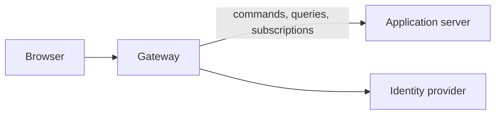

# Access Desk application

The application runs as two programs.

- **The application server** hosts the Identity and Resources contexts. It
  knows nothing of browsers, sessions, or identity providers.
- **The gateway** signs people in, keeps their sessions, and decides what each
  may send on. It holds no part of the application and reaches the server over
  the network.

A browser talks only to the gateway.



## Set it up

All of Access Desk is configured in one file, `.env`, in the root of the
repository. Copy [`.env.example`](../../.env.example) there and fill it in.
The file is ignored by Git.

Every setting is required unless the table says otherwise. Nothing is
assumed: a program that misses a setting refuses to start and names it.

| Variable                   | Read by             | Meaning                                                          |
| -------------------------- | ------------------- | ---------------------------------------------------------------- |
| `ACCESS_DESK_SERVER_HOST`  | server, gateway     | The address the application server listens on.                   |
| `ACCESS_DESK_SERVER_PORT`  | server, gateway     | The port the application server listens on.                      |
| `ACCESS_DESK_GATEWAY_HOST` | gateway, web client | The address the gateway listens on.                              |
| `ACCESS_DESK_GATEWAY_PORT` | gateway, web client | The port the gateway listens on.                                 |
| `ACCESS_DESK_WEB_HOST`     | gateway, web client | The address the web client listens on.                           |
| `ACCESS_DESK_WEB_PORT`     | gateway, web client | The port the web client listens on.                              |
| `GITHUB_CLIENT_ID`         | gateway             | Optional. The client identifier of the GitHub OAuth application. |
| `GITHUB_CLIENT_SECRET`     | gateway             | Optional. The client secret of the GitHub OAuth application.     |
| `GOOGLE_CLIENT_ID`         | gateway             | Optional. The client identifier of the Google OAuth application. |
| `GOOGLE_CLIENT_SECRET`     | gateway             | Optional. The client secret of the Google OAuth application.     |

What follows from these is worked out and is no settings of its own.

- The gateway reaches the application server where that server listens.
- The web client's development server reaches the gateway where the gateway
  listens.
- People open the application over HTTPS where the web client listens, at
  `https://<ACCESS_DESK_WEB_HOST>:<ACCESS_DESK_WEB_PORT>/`.
- An identity provider sends a person back to that address. Register it with
  each provider as the callback address.
- Only the page at that address may call the gateway.

The connection between the gateway and the application server is not secured.
See [Why the application server is not secured](#why-the-application-server-is-not-secured).

## Run it

Build once, then start each program in a terminal of its own.

```sh
pnpm --dir packages/app run build
pnpm --dir packages/app run server
pnpm --dir packages/app run gateway
```

Sign-in through GitHub is on when both GitHub variables are set, and through
Google when both Google variables are. Setting only one of a provider's
variables is refused. Nobody can sign in without at least one
provider. Each needs one OAuth
application for the whole installation; organizations set up nothing. Somebody
who signs in through both is one person when both confirm the same verified
email address. An account without a verified email address cannot sign in.

## Sign in through GitHub and Google

Both providers send people back only to an HTTPS address, so the web client
must run on `https://127.0.0.1:5173` (see its README).

1. Copy `.env.example` to `.env` in the root of the repository. It is
   ignored by Git.
2. Register an OAuth application with each provider you want, with the
   address of the web client, such as `https://127.0.0.1:5173/`, as the
   callback address, and put its client
   identifier and secret into `.env`.
3. Start the application and sign in from the web client.

## Why the application server is not secured

The gateway talks to the application server over plain HTTP/2. Nothing
encrypts what passes between them, and the server does not check who is
calling. It takes the caller's word for who is acting and in which
organization.

This is a limit of the Spine version in use, not a choice made here.

- Spine's server opens only a plain HTTP/2 listener. It takes no certificate.
- It has no place to check a caller before a request is handled.

So the server is protected by where it listens, and only by that.

- Outside containers it listens on `127.0.0.1`, which only programs on the
  same machine can reach.
- In containers it publishes no port. Only the gateway's container can reach
  it, over a network private to the three containers.

In both cases what passes between the gateway and the server never leaves the
machine, so there is nothing on a network to listen in on.

That stops being enough once the two run on different machines. Anybody who
can then reach the server can act as anybody, and can read what passes. Do
not set `ACCESS_DESK_SERVER_HOST` to an address others can reach. To run the
two apart, put what Spine lacks around the server:

- a proxy in front of it that accepts only the gateway, by mutual TLS; or
- on Kubernetes, a service mesh, which gives mutual TLS between the two
  without changing either.

Neither is set up here. The browser's side is a different matter: people open
the application over HTTPS, and every request of theirs carries a session the
gateway checks.

## The gateway's addresses

The gateway has six addresses of its own, for signing in and for the session.
Everything else a browser does is a Spine command, query, or subscription sent
to the same address; see [What passes through](#what-passes-through).

Every address of its own works the same way:

- It takes `POST` with a JSON object as the body. Send `{}` when there is
  nothing to send. The body may be at most 16 KiB.
- It answers only the page the web client serves, by the `Origin`
  header of the request.
- Where it needs a session, send the session as `Authorization: Bearer <token>`.
- It answers JSON, which must not be cached.

| Status | Body                           | Means                                                           |
| ------ | ------------------------------ | --------------------------------------------------------------- |
| `200`  | as each address tells          | Done.                                                           |
| `401`  | `{ "error": "not signed in" }` | The address needs a session, and there is none or it has ended. |
| `403`  | `{ "error": "refused" }`       | The person may not do this, or the request is malformed.        |
| `503`  | `{ "error": "try again" }`     | The gateway could not do it just now.                           |

### Signing in

A person signs in in four steps.

1. The page asks which providers it may offer: `/auth/options`.
2. The person chooses one. The page makes up a secret, keeps it, and starts
   the sign-in with the secret's fingerprint: `/auth/external/start`.
3. The page sends the browser to the address it was given. The provider
   confirms the person and sends them back to the page, with `code` and
   `state` in the address.
4. The page finishes the sign-in with those and the secret:
   `/auth/external/complete`. The answer carries the session.

#### `POST /auth/options`

Tells which identity providers a sign-in page may offer. Needs no session.

Send `{}`.

Answers `200`:

```json
{ "external": [{ "key": "github", "label": "GitHub" }] }
```

`key` is what `/auth/external/start` takes as `provider`. `label` is the name
to show. An empty list means nobody can sign in.

#### `POST /auth/external/start`

Starts a sign-in through one provider. Needs no session.

| Field           | Value                                                                               |
| --------------- | ----------------------------------------------------------------------------------- |
| `provider`      | A `key` from `/auth/options`.                                                       |
| `codeChallenge` | The SHA-256 of a secret the browser has just made up, in base64url without padding. |

The browser keeps the secret itself, 43 to 128 characters long, until the
provider sends the person back.

Answers `200` with the provider's address to send the person to:

```json
{ "authorizationUrl": "https://github.com/login/oauth/authorize?..." }
```

Answers `403` for a provider that is not set up or a missing `codeChallenge`.

#### `POST /auth/external/complete`

Finishes a sign-in and gives the person a session. Needs no session.

| Field          | Value                                                 |
| -------------- | ----------------------------------------------------- |
| `provider`     | The same `key` the sign-in was started with.          |
| `state`        | The `state` the provider put in the address.          |
| `code`         | The `code` the provider put in the address.           |
| `codeVerifier` | The secret whose SHA-256 was sent as `codeChallenge`. |

Answers `200`:

```json
{
  "token": "…",
  "person": { "id": "…", "email": "noah@acme.example", "name": "Noah Reyes" },
  "organization": null
}
```

`token` is the session. The session belongs to no organization yet.

Answers `403` when the sign-in was never started or was already finished, when
the secret does not match, or when the provider confirmed no account with a
verified email address. The gateway's console says which.

### The session

#### `POST /auth/session`

Tells who is signed in and which organizations are theirs. Call it when the
page opens, to learn whether the session it kept is still good, and again
after the person signs in, answers an invitation, or enters an organization.
Needs a session.

Send `{}`.

Answers `200`:

```json
{
  "person": { "id": "…", "email": "noah@acme.example", "name": "Noah Reyes" },
  "accounts": [{ "provider": "github", "subject": "1001" }],
  "organization": null,
  "organizations": [
    { "id": "acme", "name": "acme", "standing": "member", "role": "administrator" },
    { "id": "globex", "name": "globex", "standing": "invited", "role": null }
  ]
}
```

| Field           | Value                                                                                           |
| --------------- | ----------------------------------------------------------------------------------------------- |
| `person`        | The signed-in person.                                                                           |
| `accounts`      | The accounts the person signs in with, each by its provider and the name the provider gives it. |
| `organization`  | The organization the session has entered, or `null`.                                            |
| `organizations` | Every organization the person belongs to or is invited to.                                      |
| `standing`      | `member`, or `invited` while an invitation waits for their answer.                              |
| `role`          | `member` or `administrator` for a member, and `null` for somebody only invited.                 |

Answers `401` when there is no session or it has ended.

#### `POST /auth/organization`

Enters an organization. Call it when the person chooses one of the
organizations they are a member of. Needs a session.

| Field          | Value                                                                          |
| -------------- | ------------------------------------------------------------------------------ |
| `organization` | The `id` of an organization from `/auth/session` whose `standing` is `member`. |

Answers `200` with a new session, bound to the organization:

```json
{
  "token": "…",
  "person": { "id": "…", "email": "noah@acme.example", "name": "Noah Reyes" },
  "organization": "acme"
}
```

The earlier session stops working, so use the new `token` from then on. To
enter another organization, call this again with the new session.

Answers `401` without a session, `403` when the person is not a member of that
organization, and `503` when the session could not be issued just now.

#### `POST /auth/sign-out`

Ends the session, so its token stops working. Send `{}` with the session to
end. Answers `200` with `{}`, also when there was no session to end.

### What passes through

Commands, queries, and subscriptions go through the Spine services at the same
address, with the same `Authorization` header, as the Spine web client sends
them. The gateway judges each as it passes and refuses whatever is not listed
here.

A request names the organization it acts in, which must be the one the session
has entered. A request about an invitation names no organization, because
invitations belong to none.

| Request                                                                                | Who may send it                                                            |
| -------------------------------------------------------------------------------------- | -------------------------------------------------------------------------- |
| `AcceptInvitation`, `DeclineInvitation`                                                | A signed-in person, for an invitation sent to their own email address.     |
| `InviteMember`, `RevokeInvitation`                                                     | An administrator, for the organization they have entered.                  |
| Query on `InvitationView`, filtered by `organization` alone                            | An administrator, for the organization they have entered.                  |
| `SubmitAccessRequest`, `SubmitAccessExtensionRequest`                                  | A member, as the requester.                                                |
| `CancelAccessRequest`                                                                  | The member who made the request.                                           |
| `ApproveAccessRequest`, `DenyAccessRequest`, `RevokeAccessGrant`                       | A member, as the manager. The domain checks that they manage the resource. |
| `OpenResourceForRequests`, `CloseResourceForRequests`                                  | A manager of the resource, or an administrator.                            |
| `RegisterResource`                                                                     | An administrator.                                                          |
| Query or subscription on the organization, catalog, request, decision, and grant views | Any member of the organization.                                            |
