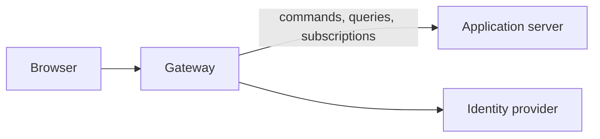

# Access Desk application

The application runs as two programs.

- **The application server** hosts the Identity and Resources bounded contexts.
  It knows nothing of browsers, sessions, or identity providers.
- **The gateway** signs people in, keeps their sessions, and decides what each
  may send on. It holds no part of the application and reaches the server over
  the network.

A browser talks only to the gateway.



## Set it up

All of Access Desk is configured in one file, `.env`, in the root of the
repository. Copy [`.env.example`](../../.env.example) there and fill it in.
The file is ignored by Git.

Every setting is required. Nothing is assumed: a program that misses a setting
refuses to start and names it.

| Variable                        | Read by             | Meaning                                                                |
| ------------------------------- | ------------------- | ---------------------------------------------------------------------- |
| `ACCESS_DESK_SERVER_HOST`       | server, gateway     | The address the application server listens on.                         |
| `ACCESS_DESK_SERVER_PORT`       | server, gateway     | The port the application server listens on.                            |
| `ACCESS_DESK_ORGANIZATIONS`     | server, database    | The organizations the server keeps, by commas.                         |
| `ACCESS_DESK_GATEWAY_HOST`      | gateway, web client | The address the gateway listens on.                                    |
| `ACCESS_DESK_GATEWAY_PORT`      | gateway, web client | The port the gateway listens on.                                       |
| `ACCESS_DESK_WEB_HOST`          | gateway, web client | The address the web client listens on, where Google sends people back. |
| `ACCESS_DESK_WEB_PORT`          | gateway, web client | The port the web client listens on.                                    |
| `ACCESS_DESK_API_HOST`          | web client          | The address the page calls the application at.                         |
| `ACCESS_DESK_API_PORT`          | web client          | The port the page calls the application at.                            |
| `GOOGLE_CLIENT_ID`              | gateway             | The client identifier of the Google OAuth application.                 |
| `GOOGLE_CLIENT_SECRET`          | gateway             | The client secret of the Google OAuth application.                     |
| `ACCESS_DESK_DATABASE_HOST`     | server, gateway     | The address of the PostgreSQL server.                                  |
| `ACCESS_DESK_DATABASE_PORT`     | server, gateway     | The port of the PostgreSQL server.                                     |
| `ACCESS_DESK_DATABASE_USER`     | server, gateway     | The account to connect to it with.                                     |
| `ACCESS_DESK_DATABASE_PASSWORD` | server, gateway     | The password of that account, written as it is.                        |
| `ACCESS_DESK_SESSION_KEY`       | gateway             | The P-256 key sessions are signed with, in base64.                     |

People sign in through Google. If the gateway cannot reach Google when it
starts, it does not start.

### The database

The application server and the gateway keep their data in PostgreSQL, so a
restart loses nothing. All the databases live on one PostgreSQL server, set by
`ACCESS_DESK_DATABASE_HOST`, `_PORT`, `_USER`, and `_PASSWORD`. For
development, [`deploy/compose.yaml`](../../deploy/compose.yaml) runs one in
Docker. From the repository root:

```sh
pnpm run postgres:start
```

Each time PostgreSQL starts, it creates any of the databases below that are
missing. Running the command again after changing `ACCESS_DESK_ORGANIZATIONS`
restarts it with the new setting.

Spine creates the tables itself, but not the databases. `pnpm run postgres:stop`
stops the PostgreSQL server. `pnpm run postgres:delete` removes it, and all
its data.

| Database                              | Used by            | What it stores                                                                                       |
| ------------------------------------- | ------------------ | ---------------------------------------------------------------------------------------------------- |
| `accessdesk_server`                   | application server | People and their accounts, subscriptions to updates, and messages that are not delivered yet.        |
| `accessdesk_resources_<organization>` | application server | The data of a single organization: its members, resources, access requests, grants, and audit trail. |
| `accessdesk_gateway`                  | gateway            | Who opened each subscription, and the sessions people signed out of.                                 |

The application server and the gateway never share a database. The gateway
gets the application's data only by asking the application server.

#### The shared database

In Spine, all contexts in one process share a single storage. Data that
doesn't belong to a particular organization goes into the shared database,
`accessdesk_server`:

- Identity: people, the accounts they sign in with, their email addresses,
  and their memberships. Identity is not split by organization.
- Subscriptions to both contexts.
- Messages waiting to be delivered, so commands accepted right before a
  restart are still handled after it.

#### Organizations

Each organization gets a separate database, named after its identifier:

```dotenv
ACCESS_DESK_ORGANIZATIONS=teamdev,codematters
```

With this setting, the databases are `accessdesk_resources_teamdev` and
`accessdesk_resources_codematters`. PostgreSQL limits a database name to 63
characters, so an identifier can be at most 42 characters long.

The application server works only with the organizations listed in
`ACCESS_DESK_ORGANIZATIONS`, and rejects requests for any other. The list is
fixed for now, because Spine does not yet remember organizations added at
runtime across restarts. To add an organization:

1. Add it to `ACCESS_DESK_ORGANIZATIONS`.
2. Run `pnpm run postgres:start` to restart PostgreSQL with the new setting
   and create its database.
3. Restart the application server.

#### Subscriptions

When a page in the browser subscribes to updates, both the gateway and the
application server keep a record of the subscription:

- The gateway records who opened it and until when, in `accessdesk_gateway`.
  This way, only that person can activate or cancel it, and the gateway can
  restore it after a restart.
- The application server records what the subscription watches and whether
  it is active, in `accessdesk_server`. It uses this to send updates, and to
  restore the subscription after a restart. A subscription to Resources
  belongs to one organization and gets that organization's updates only.

#### Sessions

The gateway does not store sessions. A session is a token signed with
`ACCESS_DESK_SESSION_KEY`, and the browser keeps the token. As a result:

- People stay signed in when the gateway restarts.
- Changing the key signs everyone out.

To generate a key:

```sh
pnpm --dir packages/app run session-key
```

The gateway passes each request on to the application server together with
who makes it, and the server trusts it, as only the gateway reaches the server.
The framework passes a signed-in person on only with a proof, so
`src/trusted-network.ts` sends a fixed proof, and has the server accept it.

A signed token stays valid until it expires, even after the person signs out.
So on sign-out, the gateway saves the token's identifier in
`accessdesk_gateway` and rejects that token from then on. Once the token
expires, the gateway deletes the identifier.

#### Tests

Tests never touch the application's databases. Each test
creates new, empty databases named `accessdesk_test_<random>`, with the same
layout as the application, and drops them when it finishes. See
[Testing model](../../.agents/project.md#testing-model).

## Run it

1. Fill in `.env`, as [Set it up](#set-it-up) tells. The session key comes
   from `pnpm --dir packages/app run session-key`.
2. Start PostgreSQL, as [The database](#the-database) tells.
3. Build once, then start each program in a separate terminal:

   ```sh
   pnpm --dir packages/app run build
   ```

   ```sh
   pnpm --dir packages/app run server
   ```

   ```sh
   pnpm --dir packages/app run gateway
   ```

People open the application in the web client,
[`packages/web`](../web/README.md). To run all of it laid out as in production
instead, see [`deploy/README.md`](../../deploy/README.md).

## The gateway's endpoints

The gateway has five dedicated endpoints, for signing in and for the session.
Everything else a browser does is a Spine command, query, or subscription sent
to the same address; see [What passes through](#what-passes-through).

Every dedicated endpoint works the same way:

- It takes `POST` with a JSON object as the body. Send `{}` when there is
  nothing to send. The body may be at most 16 KiB.
- It answers only the page the web client serves, by the `Origin`
  header of the request.
- Where it needs a session, send the session as `Authorization: Bearer <token>`.
- It answers JSON, which must not be cached.

| Status | Body                           | Means                                                            |
| ------ | ------------------------------ | ---------------------------------------------------------------- |
| `200`  | as each endpoint describes     | Done.                                                            |
| `401`  | `{ "error": "not signed in" }` | The endpoint needs a session, and there is none or it has ended. |
| `403`  | `{ "error": "refused" }`       | The person may not do this, or the request is malformed.         |
| `503`  | `{ "error": "try again" }`     | The gateway could not do it just now.                            |

### Signing in

A person signs in in four steps.

1. The page asks which providers it may offer: `/auth/options`.
2. The person chooses one. The page makes up a secret, keeps it, and starts
   the sign-in with the secret's fingerprint: `/auth/external/start`.
3. The page sends the browser to the address it was given. The provider
   confirms the person and sends them back to the page, with `code` and
   `state` in the address.
4. The page finishes the sign-in with those and the secret:
   `/auth/external/complete`. The answer carries the session.

#### `POST /auth/options`

Lists the identity providers a sign-in page may offer. Needs no session.

Send `{}`.

Answers `200`:

```json
{ "external": [{ "key": "google", "label": "Google" }] }
```

`key` is what `/auth/external/start` takes as `provider`. `label` is the name
to show. An empty list means nobody can sign in.

#### `POST /auth/external/start`

Starts a sign-in through one provider. Needs no session.

| Field           | Value                                                                               |
| --------------- | ----------------------------------------------------------------------------------- |
| `provider`      | A `key` from `/auth/options`.                                                       |
| `codeChallenge` | The SHA-256 of a secret the browser has just made up, in base64url without padding. |

The browser keeps the secret itself, 43 to 128 characters long, until the
provider sends the person back.

Answers `200` with the provider's address to send the person to:

```json
{ "authorizationUrl": "https://accounts.google.com/o/oauth2/v2/auth?..." }
```

Answers `403` for a provider that is not set up or a missing `codeChallenge`.

#### `POST /auth/external/complete`

Finishes a sign-in and gives the person a session. Needs no session.

| Field          | Value                                                 |
| -------------- | ----------------------------------------------------- |
| `provider`     | The same `key` the sign-in was started with.          |
| `state`        | The `state` the provider put in the address.          |
| `code`         | The `code` the provider put in the address.           |
| `codeVerifier` | The secret whose SHA-256 was sent as `codeChallenge`. |

Answers `200`:

```json
{
  "token": "…",
  "person": { "id": "…", "email": "noah@acme.example", "name": "Noah Reyes" },
  "organization": "acme"
}
```

`token` is the session. It works in the organization the person belongs to,
named in `organization`, or in none when that is `null`. It stops working
eight hours after sign-in, or when the person signs out.

Answers `403` when the sign-in was never started or was already finished, when
the secret does not match, or when the provider confirmed no account with a
verified email address. The gateway's console says which.

### The session

#### `POST /auth/session`

Tells who is signed in and which organization they belong to. Call it when the
page opens, to learn whether the session it kept is still good, and again
after the person signs in. Needs a session.

Send `{}`.

Answers `200`:

```json
{
  "person": { "id": "…", "email": "noah@acme.example", "name": "Noah Reyes" },
  "accounts": [{ "provider": "google", "subject": "1001" }],
  "organization": { "id": "acme", "name": "acme", "role": "administrator" }
}
```

| Field          | Value                                                                                                                                                               |
| -------------- | ------------------------------------------------------------------------------------------------------------------------------------------------------------------- |
| `person`       | The signed-in person.                                                                                                                                               |
| `accounts`     | The accounts the person signs in with, each by its provider and the name the provider gives it.                                                                     |
| `organization` | The organization the session works in, or `null` when the person belongs to none: its `id`, its `name`, and the person's `role` there, `member` or `administrator`. |

A person who was added to an organization after they signed in sees it from
their next sign-in.

Answers `401` when there is no session or it has ended.

#### `POST /auth/sign-out`

Ends the session, so its token stops working, and stops every subscription
opened under it. Send `{}` with the session to end. Answers `200` with `{}`,
also when there was no session to end, and `503` with
`{ "error": "try again" }` when the gateway could not remember that the
session ended: the token then still works, so sign out again.

### What passes through

Commands, queries, and subscriptions go through the Spine services at the same
address, with the same `Authorization` header, as the Spine web client sends
them. The gateway judges each as it passes and refuses whatever is not listed
here.

A request names the organization it acts in, which must be the one the person
belongs to. A request to Identity, such as adding a member, names no
organization.

| Request                                                          | Who may send it                                                            |
| ---------------------------------------------------------------- | -------------------------------------------------------------------------- |
| `AddMember`                                                      | An administrator, for their organization.                                  |
| Query on `MembershipView`, filtered by `organization` alone      | An administrator, for their organization.                                  |
| `SubmitAccessRequest`, `SubmitAccessExtensionRequest`            | A member, as the requester.                                                |
| `CancelAccessRequest`                                            | The member who made the request.                                           |
| `ApproveAccessRequest`, `DenyAccessRequest`, `RevokeAccessGrant` | A member, as the manager. The domain checks that they manage the resource. |
| `OpenResourceForRequests`, `CloseResourceForRequests`            | A manager of the resource, or an administrator.                            |
| `RegisterResource`                                               | An administrator, for their organization.                                  |
| Query or subscription on a read model                            | A member, as [What a member may read](#what-a-member-may-read) describes.  |
| Opening or cancelling a subscription                             | The person who made it, in the organization they made it in.               |

### What a member may read

A member reads and watches the organization and its catalog freely. Everything
else they see only where it concerns them, so a query or a subscription must
say whose it wants. It says so by one condition alone: that one column equals
one value. A request with no condition, with several, or with another one is
refused.

| Read model                 | The request must ask for                      | Who may ask                          |
| -------------------------- | --------------------------------------------- | ------------------------------------ |
| `OrganizationView`         | anything                                      | Any member.                          |
| `ResourceCatalogItem`      | anything                                      | Any member.                          |
| `AccessRequestView`        | `requester` equal to the person's identifier  | The member themselves.               |
| `AccessRequestView`        | `resource` equal to one resource's identifier | A manager of that resource.          |
| `AccessGrantView`          | `grantee` equal to the person's identifier    | The member themselves.               |
| `AccessGrantView`          | `resource` equal to one resource's identifier | A manager of that resource.          |
| `AccessDecisionAssignment` | the one kept under the person's identifier    | The member themselves, as a manager. |
| `AuditEntry`               | `resource` equal to one resource's identifier | A manager of that resource.          |
| `AuditEntry`               | anything                                      | An administrator.                    |

A subscription takes the same condition as a filter on its topic. The decision
queue is asked for by its identifier, which is the manager's identifier.
